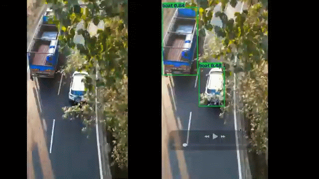

# On-The-Edge-Testing

This project sets up a lightweight Ultralytics YOLO11 workflow for edge-testing before deploying to physical devices. It includes:

- Python requirements for YOLO, OpenCV, NumPy and plotting
- An SRT-aware helper to parse synthetic bounding-box annotations
- A sample inference script that can use a local or remote image/video
- Export helpers for edge-targeted formats such as ONNX and TFLite

Quick start

1. Install dependencies:

   pip install -r requirements.txt

2. Run a YOLO11 smoke test on a sample image:

   python test_yolo.py --model yolo11n.pt --source https://ultralytics.com/images/bus.jpg --conf 0.25 --device cpu

3. Run a synthetic SRT-driven demo by pointing at an SRT file:

   python test_yolo.py --model yolo11n.pt --source samples/example.mp4 --srt data/sample_boxes.srt --device cpu

4. Export the model for edge deployment:

   python test_yolo.py --model yolo11n.pt --source https://ultralytics.com/images/bus.jpg --export onnx
   python test_yolo.py --model yolo11n.pt --source https://ultralytics.com/images/bus.jpg --export tflite

5. Use the Python helper module directly when building custom pipelines:

   from yolo_edge import parse_srt_boxes, simulate_box_data_for_frame

   boxes = parse_srt_boxes("data/sample_boxes.srt")
   simulated = simulate_box_data_for_frame((720, 1280, 3), boxes, timestamp_seconds=1.0, frame_index=10)
   print(simulated)

The repository is intentionally minimal so it can be used as a starting point for aerial inspection, industrial monitoring, or other embedded vision experiments.
